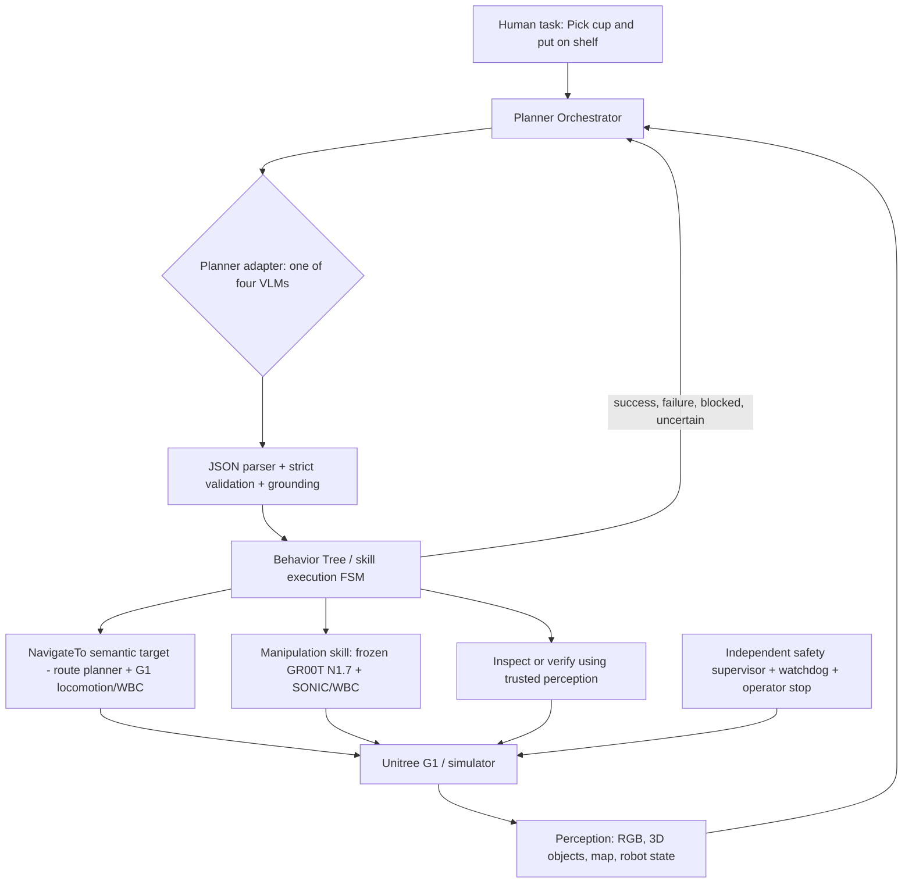

# Unitree G1 — Hierarchical VLM Planner Benchmark and Implementation Plan

**Version:** 1.0  
**Research date:** 19 October 2026  
**Scope:** four high-level VLM planners — RynnBrain-Plan-8B, RynnBrain1.1-9B, NVIDIA Cosmos 3 Edge (Reasoner), and Gemini Robotics-ER 2 — with **fixed Unitree G1 navigation and GR00T N1.7 manipulation execution skills**.  
**Status:** engineering proposal; not a claim of completed G1/VLA integration or measured model accuracy.

## 0. Critical assumptions and feasibility gates

1. **G1 embodiment must be fixed:** exact Unitree G1 revision, number of joints, hand type, head/wrist camera placement, firmware, WBC, and DDS/ROS 2 version. Avoid mixing results from different grippers or controllers.
2. **GR00T N1.7 readiness is not automatic:** the official Isaac Lab-Arena G1 box tutorial currently documents a **fine-tuned GR00T N1.6** policy. GR00T N1.7 provides G1-related tags, and NVIDIA's SONIC project documents a N1.7 → SONIC → G1 workflow using a **fine-tuned checkpoint**. Do not assume the N1.6 tutorial checkpoint is directly interchangeable or that generic N1.7 grasps/carries/places reliably on your G1. This is the main blocking item. Reproduce NVIDIA's tutorial as a controls/simulator sanity check, then independently qualify the N1.7 + SONIC execution layer.
3. **Navigation is not the VLA:** a map/localization service and certified humanoid locomotion/WBC accept navigation goals. Nav2 can be a planner/behavior interface, but `NavigateToPose` alone does not make G1 walk. Build and qualify a G1 locomotion bridge. Low-level obstacle avoidance stays outside the VLM; send high-level `BLOCKED` or `UNREACHABLE` events to the VLM only after navigation-layer recovery.
4. **The VLM proposes, never actuates:** all model outputs are untrusted proposals. Validate JSON, object IDs, preconditions, authorized rooms, skill availability and dynamic safety constraints before execution. Hard safety enforcement is local to the robot, not dependent on the cloud planner.
5. **Separately report planner-only versus end-to-end performance:** use a deterministic oracle-skill track to isolate planning; physics-based closed loop measures the whole stack.
6. **Gemini is a hosted preview endpoint:** confirm account/region access, use `gemini-robotics-er-2-preview` rather than the streaming variant for the comparable structured-JSON benchmark, record API version/cost, and comply with its data/people consent terms.
7. **Do not allow online model adaptation during held-out comparison:** prompts, checkpoint, controllers, vision front end and skill vocabulary are frozen. New training data or manual intervention creates a new experimental version.

### Success criteria for the project

- A single planner-neutral contract can invoke each of the four models on identical observations and skill inventory.
- Each model can be evaluated in reproducible **NAV**, **MAN**, **TIDY**, and **RECOVERY** suites, with per-episode state, trace, timings, video, and failure reason.
- The **same** frozen N1.7 checkpoint, controller, navigation map, sensing, and safety limits are used across all main-physics comparisons.
- Holdout results include overall success, conditional recovery, safety, latency, compute and cost, together with uncertainty intervals. No qualitative winner is declared without measured results.

## 1. Comparison hypotheses and model setup

| Candidate | Checkpoint / endpoint | Principal hypothesis | Serving path | Qualification step |
|---|---|---|---|---|
| RynnBrain-Plan-8B | `Alibaba-DAMO-Academy/RynnBrain-Plan-8B` | Specialized manipulation planning produces more feasible decompositions | Hugging Face Transformers / vLLM / SGLang (supported routes shown on model card); benchmark after testing your exact inference stack | Reproduce authors' manipulation-planning cookbook; normalize its free-form output into plan schema |
| RynnBrain1.1-9B | `Alibaba-DAMO-Academy/RynnBrain1.1-9B` | Better native 3D grounding/contact reasoning improves object choice, spatial relations and unseen scenes | Official Transformers (`transformers==5.2.0` example) or SGLang OpenAI-compatible endpoint | Run 3D grounding and planning cookbook; test structured output parsing |
| Cosmos 3 Edge | `nvidia/Cosmos3-Edge`, **Reasoner path only** | Good physical reasoning at lower serving cost and potential edge deployment | NVIDIA vLLM example: OpenAI-compatible `/v1` for the Reasoner; use pinned compatible environment | Confirm that you are invoking Reasoner text output, not generator/action trajectory branch; normalize JSON |
| Gemini Robotics-ER 2 | `gemini-robotics-er-2-preview` | Better agentic tool selection, progress monitoring, uncertainty handling | Gemini Developer API / Interactions API | Confirm preview access and spend cap; use structured output schema or function/tool calls mapped to the same plan schema |

**Licensing check:** RynnBrain checkpoints show Apache-2.0 on their Hugging Face cards. Cosmos3-Edge is under NVIDIA OpenMDW 1.1 (not Apache). GR00T N1.7 repository describes Apache-2.0. Gemini ER 2 is hosted under API terms. Re-check the full licenses and dataset/cloud-privacy constraints before production use.

### Approximate model memory sizing — not measured inference requirements

At BF16/FP16, bare dense parameter weights take approximately `2 × parameter_count` bytes: **8B ~16 GB**, **9B ~18 GB**, **4B ~8 GB**. Vision towers, buffers, KV cache, activations, CUDA graphs, context/image count and auxiliary components increase peak use substantially. Quantized weights reduce weights but may change accuracy and are a separate study. Benchmark models on the **same precision tier** when possible; if not, report platform differences honestly.

### First smoke tests (on **separate** terminals; not a complete deployment)

```bash
# Model A; pin a validated Transformers/vLLM version and model revision in the manifest.
vllm serve Alibaba-DAMO-Academy/RynnBrain-Plan-8B --port 8011

# Model B: official GitHub also documents Transformers and SGLang.
python3 -m sglang.launch_server \
  --model-path Alibaba-DAMO-Academy/RynnBrain1.1-9B --port 8012

# Model C: Cosmos 3 Edge REASONER, not its action generator.
vllm serve nvidia/Cosmos3-Edge \
  --port 8013 --max-model-len 131072 \
  --mm-processor-kwargs '{"do_resize":true,"min_pixels":4096,"max_pixels":16777216}'

# Model D: call `gemini-robotics-er-2-preview` with google-genai API client;
# credentials from secret manager, never included in benchmark logs.
```

**Warning:** The exact serving commands and dependency pins must be tested independently against the vendor checkout and compute hardware. `vllm` CUDA/kernel compatibility varies. Use read-only health/smoke checks before attaching any robot endpoint. For visual request parity, normalize the number, timing and resolution of camera frames at the benchmark gateway.

## 2. Deployment and information flow



**Computers:** (1) planner host — model A/B/C or Gemini client + task planner + world model; (2) VLA GPU host — frozen GR00T N1.7 policy server; (3) simulation workstation — Isaac Lab-Arena; (4) G1 onboard — sensors, local controller, watchdog, safety; real robot only after approvals. Network disconnect results in a local safe behavior, not autonomous control continuation.

**Scheduling:** 1–2 Hz semantic world-model updates may suffice for mission replanning (measure), while 20–100+ Hz locomotion/whole-body control continues on separate low-latency loops. Do not place an LLM or cloud API in the stabilizing control loop. Real rates must be confirmed for the selected controller and sensors.

### 2.1 Hardware and network planning

These are **practical starting configurations**, not tested minimum requirements. Profile peak VRAM and runtime with your exact image/video workload before purchase or resource allocation.

| Role | Development option | Preferred research setup | Why separate it |
|---|---|---|---|
| Sim host | Linux workstation, RTX 4090/5090 class GPU, 64–128 GB RAM, >=1 TB NVMe | 48 GB+ GPU, 128 GB RAM, >=2 TB fast NVMe | Isaac Sim render + physics + video often competes for VRAM and CPU |
| VLM planner server | 24–32 GB GPU for BF16 model **after profiling**; one model resident at a time | 48 GB+ NVIDIA GPU, 64–128 GB RAM; swap models between runs | 8–9B vision models have ~16–18 GB weights alone; high-res images and context add overhead |
| GR00T N1.7 policy server | Separate GPU; profile tuned checkpoint before deciding (24–32 GB is not guaranteed) | Dedicated 48 GB+ GPU or qualified lower-VRAM accelerated setup | Prevent model swapping and simulator contention from changing action latency |
| G1 onboard | Robot vendor-supported controller computer, cameras and low-level networking | Same, with independent watchdog and operator stop | Balance and joint control must remain local |
| Storage + logging | 2 TB NVMe, separate object storage for video | 4 TB+ / shared NFS or S3 for repeatable experiment logs | Per-episode multi-camera video and GT traces grow quickly |
| Network | Wired 1 GbE for control/test machines on an isolated lab LAN | Wired 10 GbE among servers; separate robot control VLAN | Consistent latency and containment; record packet loss and time sync |

**Hardware notes:** A 24 GB RTX 4090 may serve an 8B BF16 planner only with tight input/context limits and suitable serving implementation; do not infer it can concurrently host Isaac Sim and GR00T. An RTX 5090 has more room but must still be profiled. Jetson Thor is a possible separate edge inference study for Cosmos 3 Edge, **not** part of the fair main comparison unless the other models use an equivalent deployment setting. Hosted Gemini requires no planner GPU but the same simulation/VLA resources. Keep identical model/skill inputs; record image size, frame count and inference precision.

**Latency budget:** log `vision_capture → world_model`, `planner_request → valid decision`, `skill_start → acknowledgement`, `navigation/GR00T action chunks`, and `feedback → next decision`. A provisional objective is a few seconds P95 for semantic planning, not a hard real-time constraint. The actual SONIC VLA inference guide describes action publication near 50 Hz, 2.5 Hz inference requests, and action horizons; those are controller-specific defaults to pin and measure, not VLM planner frequencies.

## 3. Strict planner-to-robot API

### 3.1 Inputs on every decision

```json
{
  "schema_version": "1.0",
  "mission_id": "TIDY-005",
  "decision_id": "D003",
  "instruction": "Return the three misplaced objects to their designated areas",
  "robot": {"id":"g1_lab_01","pose_map":[1.20,0.85,0.0],"balance_ok":true,
            "hands":{"left":"empty","right":"empty"},"holding":[]},
  "map": {"frame":"map","locations":["table_A","shelf_B","bin_C","floor_zone","safe_staging"],
          "blocked_edges":[["table_A","shelf_B"]]},
  "objects": [
    {"id":"cup_01","class":"cup","at":"table_A","confidence":0.94,"destination":"shelf_B"},
    {"id":"bottle_02","class":"bottle","at":"floor_zone","confidence":0.87,"destination":"bin_C"},
    {"id":"box_03","class":"box","at":"table_A","confidence":0.63,"destination":"bin_C"}
  ],
  "skills": ["inspect_scene","navigate_to","pick","place","verify","wait","ask_human","abort"],
  "recent_events": [{"skill":"navigate_to","target":"shelf_B","status":"BLOCKED","code":"NO_VALID_ROUTE"}],
  "observation_refs": ["front_rgb_t100.png","front_rgb_t101.png"],
  "constraints": {"authorized_locations":["table_A","shelf_B","bin_C","floor_zone","safe_staging"],
                  "max_plan_steps":8,"must_not_enter":["restricted_room"]}
}
```

Here `observation_refs` are **resolved by the gateway into identical vision inputs**, not file paths made available to a hosted service arbitrarily. 3D scene state is created by perception/map modules; the VLM is not allowed to invent real-world coordinates.

### 3.2 Output: decision-bound, single next action plus optional short horizon

```json
{
  "schema_version":"1.0",
  "mission_id":"TIDY-005",
  "decision_id":"D003",
  "decision":"ACT",
  "step": {
    "skill":"inspect_scene",
    "target_id":"box_03",
    "params":{"view":"closer"},
    "expected_effect":"confidence_gte_0_8",
    "timeout_s":15
  },
  "rationale_brief":"The position of box_03 is not sufficiently certain.",
  "on_failure":"REPLAN"
}
```

**Decision values:** `ACT | REQUEST_OBSERVATION | REQUEST_HUMAN | ABORT | REPORT_DONE`.

**Rules:** no raw joint torques, waypoints in untrusted frames, unrestricted Python/shell calls, invented object IDs, or arbitrary tools. The tool list is whitelisted. `REPORT_DONE` requires independent completion predicates. `ABORT`/`REQUEST_HUMAN` are correct outcomes for legitimately unachievable or unsafe tasks. Runtime checks must reject steps failing reachability/preconditions before dispatch.

**Skill interface** (one logical contract, several adapters):

| Skill | Required parameters | Completion evidence | Failure events |
|---|---|---|---|
| `inspect_scene` | target/location, view | new synchronized perception packet and confidence | OCCLUDED, SENSOR_FAIL |
| `navigate_to` | approved semantic location ID | G1 base within goal tolerance and stable | BLOCKED, NO_VALID_ROUTE, LOCALIZATION_LOST, TIMEOUT |
| `pick` | object ID, optional safe grasp region | contact/grasp evidence and object attached/lifted | NO_CONTACT, SLIP, OBJECT_MISSING, TIMEOUT |
| `place` | held object ID, receptacle ID | object supported in intended region, hand released | TARGET_FULL, COLLISION_RISK, TIMEOUT |
| `verify` | predicate/object IDs | objective validator returns true/false/unknown | INDETERMINATE, SENSOR_FAIL |
| `wait` | duration / condition | elapsed or condition true | TIMEOUT |
| `ask_human` | question | operator response or timeout | DECLINED, TIMEOUT |
| `abort` | reason | safe shutdown/idle confirmed | N/A |

Navigation target IDs are resolved by a trusted map service to feasible, reachable goal poses with footprint, orientation and stance requirements; `navigate_to` must check carrying limits and terrain constraints.

### 3.3 Planner behavior

Use a consistent **receding-horizon** interface: initial `next_action` decision; call VLM again on skill status changes, unexpected observations, after a hard failure or checkpoint. This makes A/B/C/D comparable despite differences in each model's internal planning style. Save full proposed multi-step plans separately for analysis, but execute **one approved action** at a time. A separate experimental arm may compare full-horizon plans and next-action planning.

```text
mission accepted -> perceive -> request candidate next action
  -> schema validator -> ground IDs -> rule/safety check
  -> BT dispatch -> nav or GR00T skill -> verify feedback
  -> update world model -> query planner again, or finish/abort
```

### 3.4 Minimal Python pseudo-interfaces

```python
from typing import Protocol

class Planner(Protocol):
    def propose_next_action(self, observation: dict) -> dict: ...

class RobotSkillExecutor(Protocol):
    def capabilities(self) -> set[str]: ...
    def execute(self, validated_action: dict) -> dict: ...

class WorldModel(Protocol):
    def observe(self) -> dict: ...
    def verify(self, predicate: str) -> bool | None: ...
```

Implement `RynnPlanAdapter`, `Rynn11Adapter`, `CosmosEdgeReasonerAdapter`, `GeminiER2Adapter` as interchangeable clients returning this same contract. Use an independent `validate_and_bind` function; **never use a VLM to decide whether its own output is valid**.

## 4. Execution backend: qualify before comparing planners

### Gate G0: simulator and embodiment

- Pin G1 URDF/USD, degrees of freedom, hand geometry, calibrated RGB/depth sensors, kinematics, friction, mass/contact parameters, scene frame convention, WBC control rates and Isaac Sim / Isaac Lab-Arena commits.
- Reproduce Isaac Lab-Arena `galileo_g1_locomanip_pick_and_place` demonstration **as documented with N1.6**; do not report that as the N1.7 benchmark.
- Build independent mock/oracle adapters that take the same high-level skill commands but perform deterministic state transitions; test all four tasks here before physics.

### Gate G1: fixed GR00T N1.7 manipulation skills

- Select one qualified G1 hand, camera, data mapping, action normalization and N1.7 model revision. Prefer official `UNITREE_G1_SONIC` collect → fine-tune → deploy workflow if the required SONIC control stack is adopted. Distinguish base `REAL_G1` inference tag from `UNITREE_G1_SONIC` (the latter requires a post-trained checkpoint).
- Produce demonstrations covering **pick cup**, **place cup**, **pick/place each tidy object type**, and **carry while locomoting**, including recovery; fine-tune **once** before the planner trial and freeze.
- Official NVIDIA start command **after** obtaining a compatible fine-tuned G1 SONIC checkpoint (GPU policy host):

```bash
# From pinned NVIDIA/Isaac-GR00T checkout. Inference only; this does not actuate the robot.
uv run python gr00t/eval/run_gr00t_server.py \
    --model-path /path/to/your/finetuned_model \
    --embodiment-tag UNITREE_G1_SONIC \
    --device cuda:0 \
    --port 5550
```

- On the robotics client, follow NVIDIA's `GR00T-WholeBodyControl/docs/source/tutorials/vla_inference.md` for SONIC-compatible camera, motion-token decoder, controller and `run_vla_inference.py`. Use `--sim` for the initial launch; the vendor document distinguishes simulation from `real`. It specifies a 78D action space (64D motion token + 7 joints per hand). This hand/action mapping must match your actual G1 dexterous hands and associated policy training data. **Do not run the real-robot launcher based solely on this planning document.**
- Provide command/observation/rate contracts across `PolicyServer` (GPU, ZMQ), VLA inference client, SONIC decoder/C++ deploy, camera server, and WBC. Validate chunking, intervention, out-of-order messages, reset semantics and latency budget. Split locomotion from manipulation only if the joint controller arbitration can transition safely.
- Validate task-level performance **independently** of VLMs, over multiple random starts, and record intrinsic reachability/skill errors. Do not run comparison until this baseline is stable enough that planner differences can be detected.

### Gate G2: fixed navigation and locomotion

- Use map+localization -> Nav2-style `NavigateToPose` high-level service -> G1 locomotion/WBC or an alternative G1-certified navigation adapter.
- Check that it can walk between two marked positions, avoid known obstacles, detect blocked paths, replan locally, carry an object without slipping, and stop on localization loss.
- Move to planner-level navigation replanning **only after** local recovery reports `BLOCKED/NO_VALID_ROUTE` or timeout. Do not send video to the VLM at each motor-control timestep.

### Gate G3: safe transitions and independent verification

- Define explicit skill preconditions/postconditions: hands empty before pick, object held before place, arms secured for locomotion, safe stance for approach, no person in proximity if unsafe, grasp verification, speed/contact/payload envelope.
- Goal verification uses simulator ground-truth transforms for scoring (never leaked to planners) and a realistic vision/force-based observation for the robot-facing state. These are intentionally **different** views.
- Safety layer implements operator E-stop, watchdog, abort on falls/collisions, restricted zones, maximum force/speed/time, and safe response to communications failure.

## 5. Benchmarks: four task families

Run the exact same **paired scenario seeds** across all models. Each benchmark has a success predicate, hard failure conditions and perturbation dimensions.

### NAV-01: A to B, blocked-route recovery

**Initial state:** G1 at A, goal B, occupancy map and approved route graph. Mid-episode, insert a blocking object across one traversable route; a safe alternate may or may not exist.

**Expected behavior:** `navigate_to(B)`; local navigation attempts valid reroute; after `BLOCKED`, planner decides `inspect_scene`, `navigate_to(waypoint_C)` or `REQUEST_HUMAN/ABORT` when physically impossible. Never walk through a barrier based on a hallucinated shortcut.

**Success:** stable G1 base within configurable position/yaw tolerances of B, while avoiding forbidden contacts; blocked-without-alternative cases are evaluated separately for correct safe abstention. Suggested starting tolerance for benchmark design: <=0.5 m position and <=30° heading, maintained for >=2 s; final thresholds require engineering confirmation.

**Variations:** route length, 1 vs 2 corridors, dynamic obstacle arrival, uncertainty in map edge, localization drift, visibility, route fully blocked.

### MAN-01: walk → pick up a cup → carry → place

**Initial state:** cup at table A; target safe surface B; robot initially away from the cup; route and grasp configurations generated from scenario seed.

**Expected behavior:** navigate to staging pose -> inspect/locate cup -> `pick(cup)` via fixed N1.7 policy -> verify hold -> navigate to B with locomotion and carry constraints -> `place(cup, B)` via same policy -> verify release and stability.

**Success:** cup at target receptacle, stable after release for >=3 s, no drops/breakage/falls/hazardous contacts; optionally score cup pose error and unnecessary actions. Do not label success on the basis of verbal plan alone.

**Variations:** cup geometry/texture/mass, grasp approach angles, table heights, partial occlusion, route length, target placement region. First calibrate on ONE supported cup type and expand only when manipulation competency is proven.

### TIDY-01: find and return three misplaced objects

**Initial state:** exactly three named objects among distractors, destinations known to the map; objects may be placed on table, shelf or reachable floor fixture according to validated capabilities.

**Expected behavior:** inspect scene -> identify three object IDs -> for each choose pickup, waypoint, placement and verification; decide ordering to avoid unnecessary travel and account for constrained hands; recover from misplaced/missing objects without fabricating success.

**Success:** all three objects in their designated target receptacles, each released and stable; report both **full episode** and **per-object** completion. Correctly declining truly unreachable objects is measured separately from physical completion.

**Variations:** spatial distribution, distractors, swaps of visually similar items, object/target occlusion, time constraints, path obstruction, order dependencies, multiple valid orderings.

### REC-01: three failure categories

1. **Grasp failure** — deliberately inject empty grasp, slippage, or displaced object after motion begins. Measure whether the planner notices `NO_CONTACT` or `SLIP` and retries **only within a bounded budget** with updated observation.
2. **Unreachable object** — object behind barrier or outside robot's manipulation workspace. Measure alternate stance/viewpoint selection; if truly unreachable, **correct safe abstention** rather than unsafe repeated force.
3. **Observation uncertainty** — introduce occlusion or conflicting target-class probabilities. Correct behavior is active inspection/re-sensing or `ask_human` rather than unsupported confident picking.

**Success:** both a recovery-process outcome and final task outcome are logged. If ground-truth task is impossible, the recovery-process outcome rewards justified `REQUEST_HUMAN/ABORT` with a correct explanation and no safety violation, but **does not count it as task physically completed**.

## 6. Design of experiments and sample counts

### Stages

- **Stage A: interface smoke tests** — 10 prompts per model, 2 images, one route graph and one failed-skill event. Pass if model service available, images accepted, response parsed and validated, no commands executed.
- **Stage B: oracle-skill planner isolation** — 20 development episodes per family per model (320 total VLM episodes), where all requested feasible skills are simulated to succeed; add selectively injected failures to test recovery. This measures decomposition, ordering, missing-object handling and action validity separately from physics.
- **Stage C: physics pilot** — 30 matched seeds per family per model (4 × 4 × 30 = **480 episodes**) using frozen G1 controllers and N1.7 skills; run baseline non-VLM planners too.
- **Stage D: held-out physics test** — 100 *new, frozen* seeds per family per model (4 × 4 × 100 = **1,600 episodes**). Use at least five scenario templates/factors within each family; reserve some templates rather than just random numeric seeds for OOD generalization. Additional baselines increase workload.
- **Stage E: supervised hardware validation** — only for finalists passing safety and stability gates; start with static inspection, then navigation, then single pick/place. Fully instrumented, low-speed, restricted environment; never silently transition from simulation to hardware.

### Fair-comparison rules

1. Same map, scene geometry, candidate target IDs, perceptual front end, number and timing of RGB frames and world-state text. If model-dependent image resizing is necessary, retain one canonical source image and log per-adapter preprocessing.
2. Exactly the same skill library and action precondition validator for all planners.
3. Same prompt template, allowed action vocabulary, observation and history window, token/time budgets and maximum number of replans; adapter differences only for API syntax.
4. Hold the GR00T N1.7 checkpoint, navigation-controller build, ROS/DDS configuration and robot hardware fixed.
5. No model-specific repairs during held-out testing. Allow one common deterministic JSON-repair step; count invalid outputs and repairs.
6. No privileged simulator physics state in planner observations. Only scorer and fault injector can access true object positions/contacts.
7. Use paired seeds across four models with randomized execution order to reduce time/system bias. Reset world, robot, VLA session and caches per episode. Report cold/warm latency separately.
8. Separate **perception-controlled** experiments (frozen annotated observations) and **live perception** experiments, so scene recognition problems aren't misidentified as planning failures.
9. Add two baselines: (a) hand-authored Behavior Tree / PDDL-like task plan, (b) reactive rule-based next action. Optional upper bound: oracle symbolic state planner, but its privileged knowledge means it cannot be ranked as a fair VLM competitor.
10. Reserve cost and privacy accounting for Gemini separately; if external images cannot legally or ethically be sent, exclude hosted API on that dataset rather than silently alter visual inputs.

## 7. Metrics and statistical decision rule

### Task performance (core)

| Metric | Definition | Direction |
|---|---|---|
| Physical task success | `episode_goal_true / all_episodes`, from simulation GT or independent evaluator | ↑ |
| Safe resolution rate | `completed_successfully OR correct justified stop` / episodes; always report alongside physical success | ↑ |
| NAV goal achievement | goal reached within base pose tolerance, with no serious collision | ↑ |
| Per-object placement | number of correctly placed objects / three in TIDY | ↑ |
| Recovery efficacy | successfully resumed completion / recoverable injected failures | ↑ |
| Correct abstention | impossible or dangerously uncertain trials ended safely with honest reason / all such trials | ↑ |
| Grounding/hallucination | steps targeting unknown objects, map locations or unsupported skills / decisions | ↓ |
| Invalid response rate | schema-invalid or missing required fields / planner invocations | ↓ |
| Time to finish | wall-clock physical completion time, including replans | ↓ |
| Planner response P50/P95 | model request start → validated action ready; cold and warm tracked | ↓ |
| Tool efficiency | skill calls, regrasp count, unnecessary travel length, failed plans | ↓ |
| Cost and compute | API tokens/cost, GPU memory peak, watts/sampling, GPU seconds per successful task | ↓ |
| Safety violations | fall/contact force/unsafe region/watchdog violations; severity separated | Must meet hard gate |

**Primary endpoint:** mean *physical* success across the four families, equally weighted (macro average), **subject to no serious safety-violation gate failures**. Never conceal severe safety incidents in a weighted aggregate. Report each task separately.

**Intervals:** compute per-family Wilson 95% binomial intervals for success proportions; use paired bootstrap across scenario templates / paired seeds for differences between planners, plus McNemar's paired test when appropriate. Preserve repeated measures and report absolute difference in percentage points with CI. Correct confirmatory multi-model comparisons (Holm familywise adjustment), and pre-register winning conditions. 

**Suggested final selection policy:** eligibility first (no serious safety failures, control-system readiness, deployment/privacy acceptability), then highest mean held-out completion and recovery; use 95% uncertainty intervals to avoid overstating small differences; break ties with P95 planning latency, lower invalid-call rate and lower operating cost. If evidence is inconclusive, retain multiple candidates.

### Event logging schema

Each episode log captures: `run_id`, `scenario_id`, `seed`, `model_id`, `model_revision`, `prompt_hash`, `skill_checkpoint_sha`, `nav_build_sha`, `sim_build_sha`, `world_manifest_sha`, timestamps, GPU data, per-decision request/response hashes, schema validation outcome, chosen skill, skill status/error, safety events, mission status, ground-truth predicates, API cost, videos/sensor-trace artifact URIs.

**Privacy/security:** uploaded people and private spaces require consent/terms review; minimize cloud content, blur faces where appropriate, strip credentials, separate service and actuator networks; make replay logs access-controlled.

## 8. Method to distinguish planner failures from execution failures

Example: planner selects `pick(cup_01)` and G1 fails because gripper force was inadequate.

- **Planner choice valid?** yes, provided cup was known and reachable.
- **Manipulation skill success?** no; log `SKILL_ERROR/NO_CONTACT`.
- **Recovery planner quality?** evaluate subsequent planner decision after the failure observation.
- **End-to-end success?** no unless the robot subsequently recovers and completes.

Use a failure taxonomy:

1. `PLANNER_INVALID_OUTPUT`: malformed JSON/schema.
2. `PLANNER_INVALID_GROUNDING`: nonexistent object/target or unsupported skill.
3. `PLANNER_PRECONDITION_ERROR`: impossible ordering or object held mismatch.
4. `PLANNER_BAD_RECOVERY`: failed to inspect/retry/re-route/abort appropriately after feedback.
5. `PERCEPTION_ERROR`: object mislocalization or bad observations shared across planners.
6. `NAVIGATION_FAILURE`: controller or map issues.
7. `MANIPULATION_FAILURE`: frozen GR00T skill/contact failure.
8. `HARDWARE/NETWORK/SAFETY`: physical or infrastructure events.
9. `TIMEOUT`: with owning subsystem; never lump all timeouts into planning.

Show confusion matrices and representative videos for each class, not only an overall success bar chart.

## 9. Implementation components and ownership

| Component | Main responsibilities | Deliverable and test |
|---|---|---|
| Model adapters (4) | encode image/text request; call local service or Gemini; return normalized output | identical schema/vision smoke test |
| Planner gateway | world packet assembly, policy prompt, schema validation, ID binding, retries, throttling, spend caps | deterministic contract tests and unsafe-output rejection |
| Task executive | BT/FSM with allowed transitions and mission state | fault-injection unit tests |
| Semantic map + perception | camera sync, object IDs/confidences, map topology and object destinations | holdout scene recognition evaluation |
| Navigation adapter | semantic destination → safe pose; local route planning + locomotion handoff | NAV-01 with and without obstacle |
| Manipulation adapter | N1.7 policy server + G1 hands + WBC; verify grasp/place | successful cup pick/place/carry demonstrations |
| Simulator environment | Isaac Lab-Arena G1, randomized scenes, injected failures, oracle skill interface | reproducible seeded resets |
| Evaluator | independent GT predicates, metrics, bootstrap, logs/videos | unit tests and reproducibility report |
| Operator controls | hold-to-run, E-stop, safety supervisor, hard bounds, interlocks | safety drill and real-robot approval |

### Suggested source tree

```text
g1-planner-benchmark/
├── docs/                  # architecture, SOPs, gate checklists
├── config/                # robot/scene/model revisions and task definitions
├── schema/                # planner request/response, skill events
├── planner_adapters/      # RynnPlan, Rynn11, Cosmos, Gemini
├── world_model/           # images, semantic objects, map, history
├── executive/             # BT/FSM and action validator
├── skills/
│   ├── nav/               # Nav2-like bridge → verified G1 locomotion
│   ├── gr00t/             # fixed N1.7 → SONIC/WBC integration
│   └── perception/        # locate/inspect/verify
├── simulation/            # Arena tasks, randomization, failure injection
├── benchmarks/            # NAV, MAN, TIDY, RECOVERY test manifests
├── evaluation/            # scoring, paired statistics, failure taxonomy
├── tools/                 # dry-run, trace replay, experiment launcher
└── tests/                 # schema, controller, safety, regression
```

### Pseudocode for mission run

```python
def run_episode(scenario, planner, skill_executor, world, judge, policy):
    world.reset(scenario.seed)
    while not judge.goal_reached() and not judge.expired():
        observations = world.observe_public()        # no GT leak
        proposed = planner.propose_next_action(observations)
        decision = policy.validate_bind_and_authorize(proposed, observations)
        if decision.is_invalid:
            world.record_invalid(decision)
            if world.invalid_budget_exceeded(): return "invalid_plan"
            continue
        if decision.is_abort_or_human_request:        # safe adjudication
            return judge.judge_resolution(decision)
        result = skill_executor.execute(decision.action)
        world.update_from_skill_result(result)
        if result.safety_fault: return "safety_abort"
    return judge.score()
```

`judge.goal_reached()` in simulator reads independent GT only; never pass it into `world.observe_public()`.

## 10. Roadmap, estimated effort, and acceptance gates

**Indicative 8–12 week sequence, assuming an existing G1 simulation setup and robotics engineers; unknown data-collection/skill fine-tuning can extend the timeline.**

| Sprint | Implementation | Acceptance gate |
|---|---|---|
| Weeks 1–2 | Freeze hardware/embodiment, git SHA dependencies, model smoke tests, planner request+response schema, oracle executor | all four models answer same 10 image-grounded tasks and all unsafe schema outputs rejected |
| Weeks 2–4 | Reproduce G1 Isaac Lab-Arena N1.6 tutorial **only for simulation sanity**; separately bring up N1.7 SONIC pipeline and G1 locomotion | manipulation and navigation run with replayable successful episodes in controlled scene; if not, **do not claim end-to-end evaluation** |
| Weeks 4–6 | Extend from cup to three objects; build NAV/MAN/TIDY/RECOVERY scene generators, failure injection, trusted scoring | deterministic resets, GT is scorer-only, manipulation skills stable |
| Weeks 6–7 | 4 VLM clients, frozen prompt, oracle-skill benchmark, physics pilot; inspect failure taxonomy | complete 480 physics pilot episodes only after execution gate; verified logs/videos |
| Weeks 8–9 | Tune only on development set, then freeze model adapters and pre-register final protocol | no test-seed exposure or model-specific exceptions |
| Weeks 9–10 | Run 1,600 episode held-out comparison, produce stratified metrics/CI, paired analysis | winner/tie decision based on pre-declared criteria |
| Weeks 11–12 | Validate finalists on real G1 under operator-controlled safety SOP; test out-of-distribution navigation and pick/place | repeatable success and zero serious safety gate violations |

**Minimum personnel:** robotics/WBC engineer (1), VLA/model engineer (1), sim/evaluation engineer (1), VLM/orchestration engineer (0.5–1), safety reviewer/operator as needed. Parallelize model smoke tests and simulator tasks, not hardware approval.

### Gate-based fallbacks

- **If N1.7 is not stable:** complete oracle-skill planner comparison first; **do not replace N1.7 silently**. An optional N1.6 engineering sanity arm may run but is clearly labeled separate.
- **If G1 walking with object is not validated:** test stationary manipulation and NAV separately; hold MAN/TIDY end-to-end score as *not qualified*.
- **If Gemini access unavailable:** mark unavailable, not zero accuracy; run three-model benchmark and rerun Gemini later on identical frozen episode data.
- **If one model cannot parse comparable frame input:** record a serving/input compatibility failure; do not alter the test distribution to help only that model.
- **If a failure injection makes the task impossible:** grade correct safe stop in a separate column; never inflate physical success.

## 11. Immediate next 12 engineering tickets

1. Specify exact G1 hardware (number of joints and hand type), camera configuration, and safe workspace.
2. Clone and pin Isaac Lab-Arena G1 example revisions; replay tutorial demonstrations.
3. Reproduce official GR00T N1.7 + SONIC G1 demonstration on identical robot hardware/sim; establish single-task success baseline.
4. Build `RobotSkillExecutor` with no-op/oracle backend first.
5. Build `NavigateToSemanticLocation` bridge with map-approved goals and feedback; test G1 WBC transitions.
6. Implement JSON schemas, validator and safety arbiter; fuzz against malformed/extraneous tool calls.
7. Create four model adapters, endpoints and request hashing.
8. Standardize camera snapshots and world model packets; create prompt fixtures.
9. Implement NAV-01 obstacle injection and independent ground-truth goal checker.
10. Add cup MAN-01 and multi-object TIDY-01 from fixed manipulation competencies.
11. Add REC-01 simulated failure scheduler, sensor uncertainty and safe-stop scoring.
12. Freeze manifests and execute pilot + held-out benchmark, then publish results and videos.

## 12. Source references (verified 19 October 2026)

- RynnBrain-Plan-8B model card: https://huggingface.co/Alibaba-DAMO-Academy/RynnBrain-Plan-8B
- RynnBrain1.1-9B model card: https://huggingface.co/Alibaba-DAMO-Academy/RynnBrain1.1-9B
- RynnBrain model repository and cookbook: https://github.com/alibaba-damo-academy/RynnBrain
- RynnBrain 1.1 technical report: https://arxiv.org/abs/2607.17977
- Cosmos3-Edge model card (Reasoner/vLLM instructions): https://huggingface.co/nvidia/Cosmos3-Edge
- Gemini Robotics ER 2 official API guide: https://ai.google.dev/gemini-api/docs/robotics-overview
- GR00T N1.7 repository: https://github.com/NVIDIA/Isaac-GR00T
- GR00T N1.7 model embodiment tags: https://github.com/NVIDIA/Isaac-GR00T/blob/main/gr00t/data/embodiment_tags.py
- Official G1 SONIC VLA workflow: https://github.com/NVlabs/GR00T-WholeBodyControl/blob/main/docs/source/tutorials/vla_workflow.md
- Official G1 SONIC inference: https://github.com/NVlabs/GR00T-WholeBodyControl/blob/main/docs/source/tutorials/vla_inference.md
- Isaac Lab-Arena G1 loco-manipulation example (currently N1.6): https://github.com/isaac-sim/IsaacLab-Arena/blob/main/docs/pages/example_workflows/locomanipulation/index.rst
- Unitree MuJoCo SDK testing simulator: https://github.com/unitreerobotics/unitree_mujoco
- Unitree RL Lab G1 simulation/controller baseline: https://github.com/unitreerobotics/unitree_rl_lab
- VoLoAgent (inspiration for VLM orchestration and failure analysis): https://github.com/NVlabs/VoLoAgent

**Note:** Sources describe project/model capabilities, not benchmark results for these four planners on a frozen N1.7 G1 backend. All numeric thresholds, scene counts and schedules in this document are **proposed experiment parameters**, subject to engineering qualification, not observed findings.
